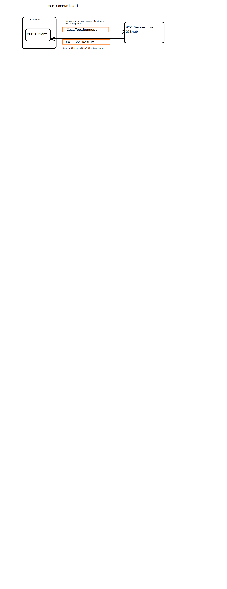

# Playwright_MCP

A learning project exploring the **Model Context Protocol (MCP)** and how it integrates with **Playwright** for browser automation.

## Overview

MCP is a communication layer that provides LLMs (like Claude) with context and tools without requiring developers to write and maintain large amounts of integration code. This repository documents the core concepts and contains a working MCP setup.

## What's Inside

| Path | Description |
|------|-------------|
| [.mcp.json](.mcp.json) | MCP server configuration that registers the Playwright MCP server |
| [notes/](notes/) | Learning notes covering MCP fundamentals: tools, resources, prompts, and architecture |
| [image/](image/) | Architecture diagrams (MCP architecture, MCP servers, chat application, GitHub tools, MCP communication) |

## MCP Basics

MCP has three basic components:

- **Tools** — Implemented on a server; extend an LLM's capabilities and are consumed by the LLM
- **Resources** — Any kind of document or information a server delivers to clients, allowing servers to share data
- **Prompts** — Pre-optimized prompts that servers provide to clients

### Why MCP?

- Anyone can author MCP servers — often the service provider itself releases an official implementation
- MCP servers provide **tool schemas + functions already defined for you**, shifting the burden of tool definitions and execution onto the server
- Instead of authoring hundreds of tool schemas yourself (e.g., for a full GitHub chatbot), you reuse a GitHub MCP server that wraps the service's functionality as a set of tools

### MCP Communication

The MCP specification defines different types of messages that can be exchanged between clients and servers — how servers expose tools, resources, and prompts, and how clients send requests to and receive responses from them.



## Setup

The project uses the official Playwright MCP server via `npx`:

```json
{
  "mcpServers": {
    "playwright": {
      "type": "stdio",
      "command": "npx",
      "args": ["-y", "@playwright/mcp@latest"]
    }
  }
}
```

### Prerequisites

- [Node.js](https://nodejs.org/) (for `npx`)
- A MCP-capable client (e.g., Claude Desktop, VS Code Copilot, etc.)

### Usage

1. Clone the repository.
2. Point your MCP client at the `.mcp.json` configuration (or copy it into your client's config).
3. The Playwright MCP server exposes browser automation tools (navigate, click, type, screenshot, etc.) to your LLM client.

## Resources

- [Model Context Protocol documentation](https://modelcontextprotocol.io/)
- [Playwright MCP](https://github.com/microsoft/playwright-mcp)
- [uv — Python package installer](https://github.com/astral-sh/uv)
