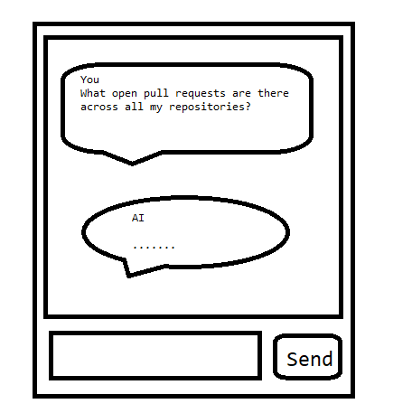
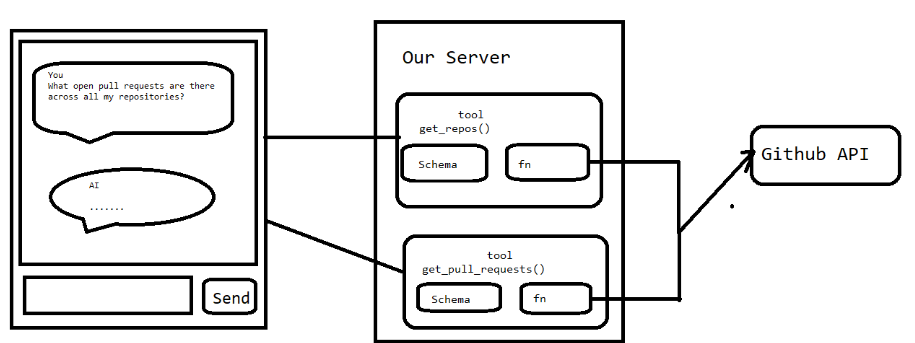
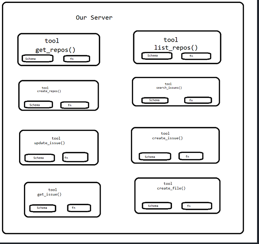
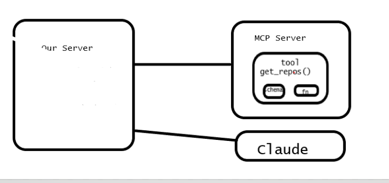

# Introduction to Model Context Protocol:

Overview of MCP - Understand what problems MCP solves

MCP Clients and Servers - MCP architecture - Servers host resources, tools and more. Clients use servers

3 Basic components of MCP

	Tools - Tools are implemented on a server and extend an LLM's capabilities - which are intented to consume by Large Language Models (LLM)

	Resources - Servers can deliver any kind of document or information to clients - which allows servers to share the data with clients

	Prompts - Servers can provide clients with pre-optimized prompts

What you need:

Basic Python fundamentals:

Essentials syntax,loops and functions

Python installation with the UV CLI

Install directions for UV at github.com/astral-sh/uv

Model COntext Protocal(MCP) - MCP is communication layer design to provide claude with context and tools with out requiring you the developer to write bunch of tidious code

Sample App

Chat interface, Using a LLM with tools that can access a user's Github account

Claude will need a set of tools to access the user's data

Github has tremendious amount of functionalities, there are repositores, pull requests, issues, projects and tons of other things, to have complete Github chat bot we have to offer tremendious amount tools

Tool Functions

To handle all of Github's functionality, we have to create an incredible number of tool schemas and functions

This is all code that we (developers) have to write, test and maintain, that's lot of effort and burden be placed on us, these challenge of making developers maintain in big set of integration is one of the primary difficulties that MCP is aims to solve

MCP shifts the burden of tool definitions and execution onto MCP Servers

these MCP server provides access to data or functionality implemented by some outside service

I may have github MCP server that can access to data and functionality provided specifically github

wrapping up of tons of functionality around github  and placing it into MCP server in the form a set of tools

This point we have very basic understadning of what a MCP server is it gives access to set of tools and exposes functionality related to some outside service the benefit here you and i have to author all these different tools schemas and functions and so on

======================================================================

Now i want to first address some of the common Questions when some one first learning about MCP servers

============================================================

Who authors the MCP servers? the answer is Any one, Any one can make MCP Server implementation but very often service providers will release official MCP implementaion for example AWS might going to release their official MCP implementation

	Anyone! Often the service provide itself will make their own MCP implementation. You can make a MCP server to wrap up access to some service

How is using an MCP server different from just calling a service's API directly?

	MCP Servers Provide tool schemas + functions

If you want to directly call an API directly, you will be authroing those on your own 

Sounds like MCP Servers and tool use are the same thing.

	MCP Servers provide tool schemas + functions already defined for you

====================================================================================
